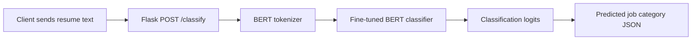

# Resume Scanner — BERT-Based Resume Classification API

A Python/Flask proof of concept that predicts a resume's occupational category from supplied **text** using a fine-tuned BERT sequence classifier.

> **Status:** Experimental ML inference API. The repository code does not currently expose a resume-upload interface, an autonomous agent, or an LLM-powered rewrite workflow.

## Architecture



## Current features

- Flask HTTP endpoint for classification
- BERT tokenizer with input truncation to 512 tokens
- `BertForSequenceClassification` inference via PyTorch
- Predicted label selected from a fixed list of occupational categories

## Repository structure

```text
RESUME_SCANNER/
├── app.py             # Flask endpoint + BERT inference
├── README.md          # Setup and API documentation
└── docs/
    └── architecture.md
```

The code expects a local model directory `models/saved_bert_model`. That model directory was **not confirmed present** during this repository review; provide a compatible trained model before attempting to start the server.

## Local setup

Recommended: Python 3.11 in a virtual environment.

```bash
python -m venv .venv
# Windows: .venv\Scripts\activate
# macOS/Linux: source .venv/bin/activate
pip install Flask torch transformers
python app.py
```

The tokenizer may download `bert-base-uncased` on first use. The model must already exist at `models/saved_bert_model`; otherwise startup will fail.

## API usage

```http
POST /classify
Content-Type: application/json

{"text": "Python developer experienced in backend APIs and machine learning"}
```

The response has the shape:

```json
{"category": "<predicted occupational category>"}
```

Example with curl:

```bash
curl -X POST http://127.0.0.1:5000/classify \
  -H "Content-Type: application/json" \
  -d '{"text":"Python developer with ML and API experience"}'
```

Do not treat the predicted category as an objectively correct job recommendation; performance depends on training data and the unavailable model weights.

## Limitations

- No model artifacts or reproducible training pipeline were verified in this repository.
- Current code loads model weights at application startup and assumes a local directory layout.
- No authentication, rate limiting, input-size validation, or inference tests are currently demonstrated.
- The source enables Flask debug mode for local development; **never expose it publicly**.
- No REST frontend, PDF parsing, ATS score, job matching, RAG, or agent orchestration is implemented in the inspected `app.py`.

## Next engineering steps

See [architecture and restructuring plan](docs/architecture.md). Suggested next milestones: modular inference service, validated request schemas, model configuration, tests with lightweight mock models, Docker setup, and evaluation metrics.

**ML classification is not the same thing as generative AI.** This project intentionally documents its existing BERT classification behavior without claiming unsupported LLM features.
