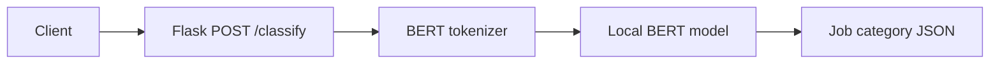

# Resume Scanner architecture and modernization plan

## Verified current state
`app.py` defines one Flask `POST /classify` route, loads a local BERT sequence classification model, tokenizes input text, runs PyTorch inference, and maps the predicted class to an occupational label.

## Present flow


## Proposed modular structure (not yet implemented)
```text
backend/
  app/
    api/           # Flask/FastAPI routes
    inference/     # Model loader and prediction logic
    schemas/       # Request and response validation
    core/          # Settings and logging
  tests/           # Model-mocked API tests
models/            # Local model artifact location, never hardcode secrets
docs/
```

## Refactor priorities
1. Confirm availability and provenance of the fine-tuned `models/saved_bert_model` artifacts.
2. Add error handling for invalid JSON, empty inputs, and missing model files.
3. Isolate tokenization and inference from the web layer to enable mock-based tests.
4. Pin compatible dependencies and add a repeatable setup.
5. Measure classifier accuracy on a held-out labeled dataset, report label mapping and limitations.
6. Only introduce an LLM-based explanation or agent workflow as a separately implemented, evaluated feature.

Avoid claiming PDF extraction, ATS matching, RAG, or autonomous agents without source and tests.
